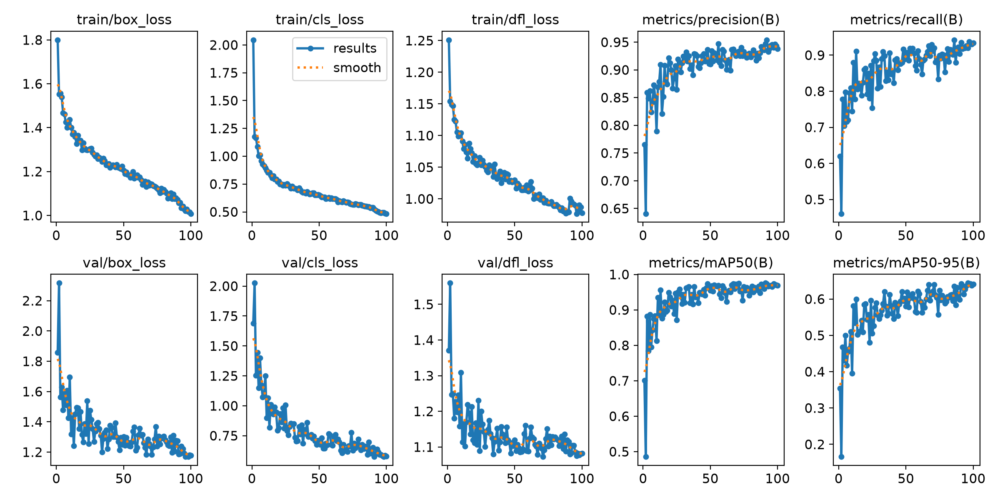
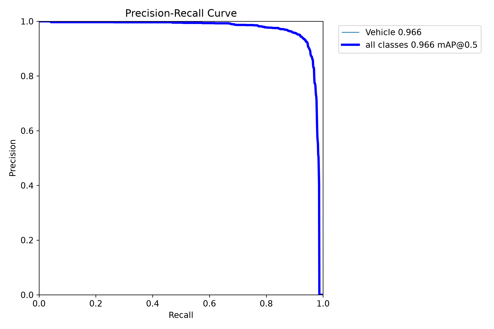
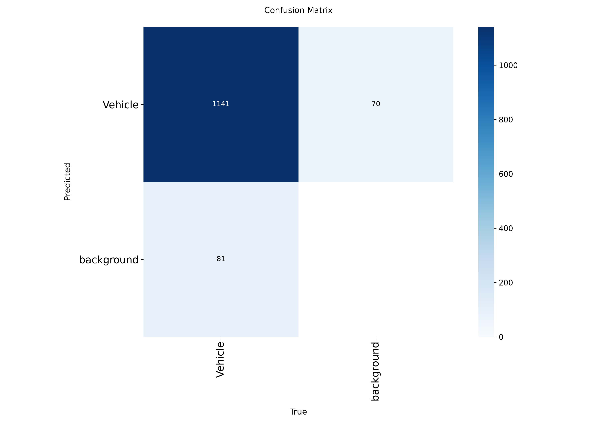
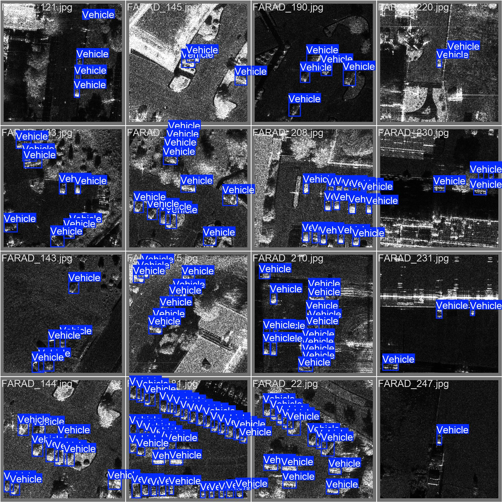
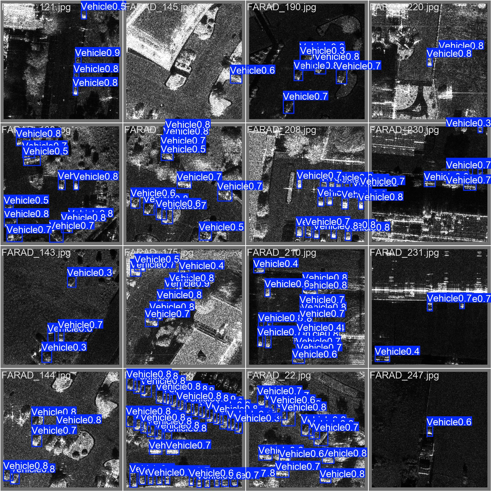
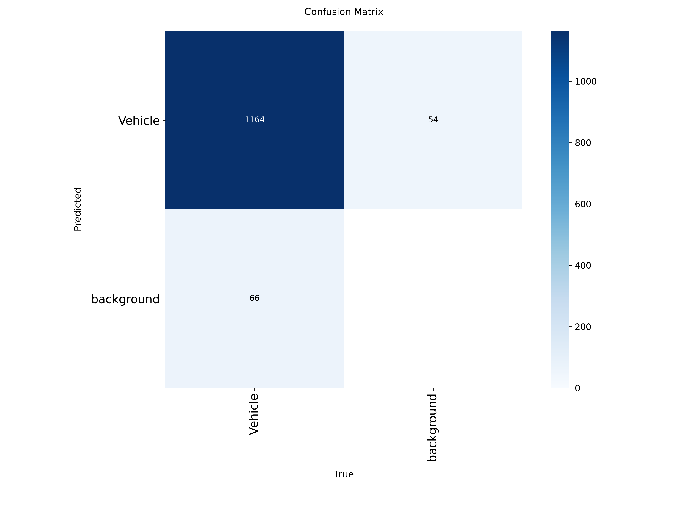
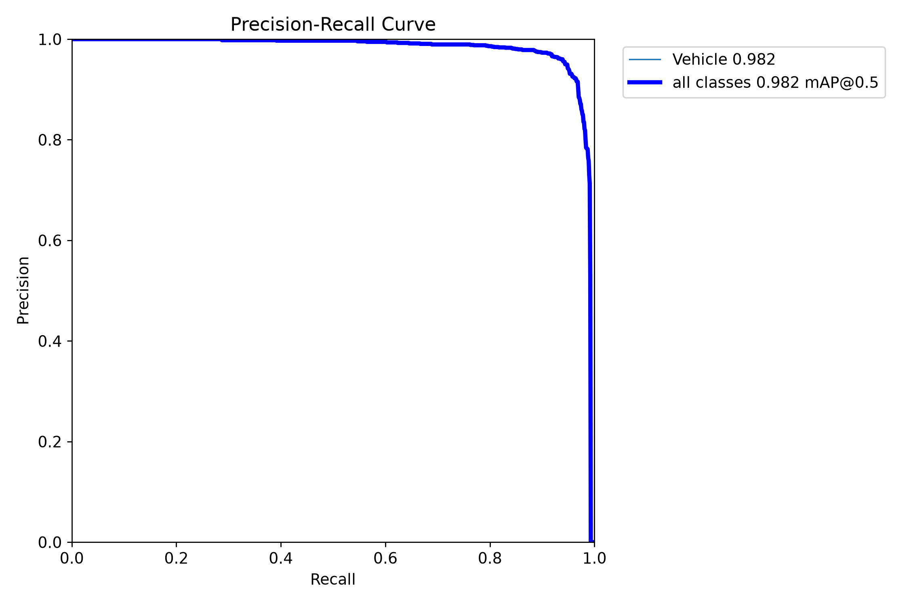

# Обнаружение транспортных средств на РЛИ-изображениях

Проект по обработке радиолокационных изображений (РЛИ / SAR) и обнаружению
транспортных средств нейросетевой моделью **YOLO12n**. Включает полный цикл:
подготовку датасета, конвертацию разметки, обучение модели, оценку качества и
веб-приложение на **Streamlit** для демонстрации работы.

---

## О проекте

Радиолокационные изображения снимаются в любую погоду и в любое время суток,
но визуально они плохо читаемы: спекл-шум, отсутствие цвета, техника выглядит
как яркие пятна. Классические методы обработки изображений (бинаризация, метод
Канни) на таких снимках дают много ложных срабатываний и требуют ручного
подбора параметров под каждый кадр, поэтому для обнаружения объектов
используется обученная нейросеть.

Задачи проекта:

1. подготовить датасет SIVED и привести его разметку к формату YOLO Detect;
2. сформировать обучающую, валидационную и тестовую выборки;
3. обучить модель обнаружения объектов одного класса `Vehicle`;
4. оценить качество модели на валидационной и тестовой выборках;
5. реализовать приложение, которое объединяет классическую обработку
   изображения и запуск обученной модели.

## Возможности приложения

- загрузка изображения с компьютера или по прямой URL-ссылке;
- декодирование и проверка изображения через OpenCV;
- уменьшение ширины изображения до 1024 пикселей для обработки;
- перевод в оттенки серого;
- пороговая обработка: бинарная, обратная бинарная, метод Оцу, адаптивная
  средняя и адаптивная гауссова;
- выделение границ методом Канни с настройкой порогов и сглаживания;
- обнаружение транспортных средств моделью YOLO12n с настройкой порога
  уверенности и IoU;
- таблица обнаружений с координатами и уверенностью по каждому объекту;
- вкладки сравнения результатов классической обработки и нейросети;
- скачивание результатов обработки в PNG.

## Данные

Используется открытый датасет **SIVED** — набор РЛИ-изображений для
обнаружения транспортных средств, снятых в Ka-, Ku- и X-диапазонах.

| Источник | Диапазон | Поляризация | Разрешение | Изображений |
| --- | --- | --- | --- | --- |
| FARAD | Ka / X | VV / HH | 0.1 × 0.1 м | 621 |
| MiniSAR | Ku | — | 0.1 × 0.1 м | 100 |
| MSTAR | X | HH | 0.3 × 0.3 м | 323 |
| **Итого** | | | | **1044** |

Разбиение выборок и объём разметки:

| Выборка | Изображений | Объектов `Vehicle` |
| --- | --- | --- |
| train | 837 | 9561 |
| valid | 104 | 1222 |
| test | 103 | 1230 |
| **Итого** | **1044** | **12013** |

Размер изображений — 512 × 512 пикселей.

Скачать датасет: [Google Drive](https://drive.google.com/drive/folders/1ntqNSMQqMwu8RE4uK2z632cMQEi4yid6) ·
[Baidu Netdisk](https://pan.baidu.com/s/1zCkCAunf8t-jAoWjH8p6-Q?pwd=megp).

> Сами изображения и разметка в репозиторий не включены — датасет скачивается
> отдельно и подготавливается скриптом (см. ниже).

## Подготовка разметки

Исходная разметка SIVED хранится в формате **DOTA**: объект описывается
четырьмя точками повёрнутого прямоугольника.

```
Исходный формат (DOTA / OBB):     x1 y1 x2 y2 x3 y3 x4 y4 Vehicle 0
Формат для обучения (YOLO Detect): 0 x_center y_center width height
```

Конвертация выполняется скриптом `scripts/prepare_dataset.py`: по координатам
четырёх точек строится внешний горизонтальный (неориентированный) bounding box,
координаты обрезаются по границам изображения и нормируются на его ширину и
высоту. Такой формат соответствует стандартной задаче YOLO Detect.

Дополнительно `scripts/fix_labels.py` проверяет корректность разметки:
диапазоны значений, класс объекта, соответствие количества изображений и
аннотаций, и сохраняет исходную DOTA-разметку в `dataset/labels_dota_backup`.

## Обучение модели

| Параметр | Значение |
| --- | --- |
| Модель | YOLO12n (режим Detect) |
| Класс | `Vehicle` (1 класс) |
| Эпох | 100 |
| Размер изображения | 512 |
| Batch | 8 |
| Patience | 100 |
| Устройство | NVIDIA GeForce RTX 4050 Laptop GPU |
| Время обучения | ≈ 26 минут |
| Параметров в модели | 2 568 243 |

По ходу обучения использовался train-набор, valid применялся для контроля
качества и выбора лучшей модели (`best.pt`). Тестовая выборка при обучении не
использовалась.

## Результаты

**Валидационная выборка** (модель `best.pt`, эпоха 96):

| Precision | Recall | mAP50 | mAP50-95 |
| --- | --- | --- | --- |
| 0.945 | 0.920 | **0.966** | **0.644** |

**Тестовая выборка:**

| Метрика | Значение |
| --- | --- |
| mAP50 | 0.982 |
| True Positive | 1164 |
| False Positive | 54 |
| False Negative | 66 |
| Precision | ≈ 95.6 % |
| Recall | ≈ 94.6 % |
| F1 | ≈ 95.1 % |

Всего на тестовой выборке 1230 размеченных объектов: 1164 + 66 = 1230, то есть
модель нашла почти все объекты при небольшом числе ложных срабатываний.

### Графики и матрицы ошибок

Кривые обучения (потери и метрики по эпохам):



PR-кривая на валидации:



Матрица ошибок на валидации:



Пример обнаружения на валидации (слева — разметка, справа — предсказание):




Матрица ошибок и PR-кривая на тестовой выборке:




## Структура репозитория

```
.
├── app.py                        # Streamlit-приложение
├── train.py                      # обучение модели YOLO12n
├── sived.yaml                    # конфигурация датасета для Ultralytics
├── requirements.txt              # зависимости
├── run_app.bat                   # запуск приложения (Windows)
├── run_train.bat                 # запуск обучения (Windows)
├── models/
│   └── sived_yolo12n_best.pt     # обученная модель (best.pt)
├── scripts/
│   ├── prepare_dataset.py        # подготовка датасета SIVED → YOLO
│   └── fix_labels.py             # проверка и нормализация разметки
└── docs/
    └── metrics/                  # графики обучения и метрики
```

Папки `dataset/` и `runs/` создаются локально и в репозиторий не попадают.

## Установка и запуск

### 1. Зависимости

```bash
python -m venv .venv
.venv\Scripts\activate          # Windows
pip install -r requirements.txt
```

Для работы на GPU установите сборку PyTorch под свою версию CUDA, например:

```bash
pip install torch torchvision --index-url https://download.pytorch.org/whl/cu128
```

### 2. Подготовка датасета

Скачайте датасет SIVED и укажите путь к его корню (папке с `ImageSets`):

```bash
python scripts/prepare_dataset.py --source D:/SIVED-main/SIVED-main
```

Скрипт создаст структуру:

```
dataset/
  images/{train,valid,test}/*.jpg
  labels/{train,valid,test}/*.txt
```

### 3. Обучение

```bash
python train.py
```

Результаты складываются в `runs/detect/sived_yolo12n_100`: веса `best.pt` и
`last.pt`, графики, матрицы ошибок и `results.csv`.

### 4. Приложение

```bash
streamlit run app.py
```

Приложение откроется в браузере (по умолчанию `http://localhost:8501`) и
использует модель `models/sived_yolo12n_best.pt`. На Windows можно просто
запустить `run_app.bat`.

## Технологии

- Python, OpenCV — классическая обработка изображений;
- Ultralytics YOLO12n — обнаружение объектов;
- PyTorch + CUDA — обучение и инференс;
- Streamlit — веб-интерфейс;
- NumPy, pandas, Pillow.

## Источник данных и цитирование

Датасет SIVED распространяется отдельно от этого репозитория. Если вы
используете его в своей работе, сошлитесь на авторов:

```bibtex
@Article{rs15112825,
  AUTHOR  = {Lin, Xin and Zhang, Bo and Wu, Fan and Wang, Chao and Yang, Yali and Chen, Huiqin},
  TITLE   = {SIVED: A SAR Image Dataset for Vehicle Detection Based on Rotatable Bounding Box},
  JOURNAL = {Remote Sensing},
  VOLUME  = {15},
  YEAR    = {2023},
  NUMBER  = {11},
  ARTICLE-NUMBER = {2825},
  URL     = {https://www.mdpi.com/2072-4292/15/11/2825},
  ISSN    = {2072-4292},
  DOI     = {10.3390/rs15112825}
}
```

## Возможное развитие

- обучение модели в режиме **OBB** (повёрнутые рамки) — исходная разметка
  содержит углы объектов, что позволило бы точнее определять ориентацию
  техники;
- увеличение разрешения при обучении и тестировании;
- сравнение с другими архитектурами детекторов.
